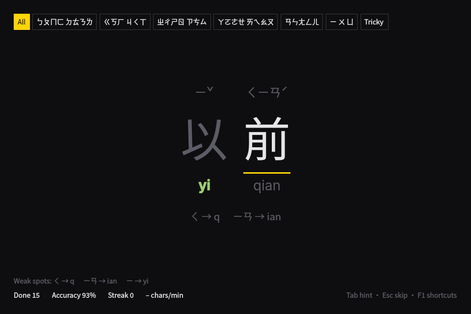

# Bopopin 拼音練習

English | [正體中文](README.md)

**Know zhuyin? Type pinyin.**



Pinyin typing practice for people who already know zhuyin. It shows a word in
Traditional Chinese with its zhuyin, and you type the pinyin. A wrong key only
shakes the character; Tab shows how its zhuyin becomes the spelling (ㄌ → l,
ㄧㄡ → iu), and a missed word comes back a few words later.

It remembers which sounds you miss, between runs too, and picks words with
those sounds more often until you get them right again.

Letters are read straight from the keyboard, so it works while a Chinese input
method such as Chewing is switched on.

## Lessons

| Lesson | Drills |
| --- | --- |
| All | every word |
| ㄅㄆㄇㄈ ㄉㄊㄋㄌ | b p m f d t n l |
| ㄍㄎㄏ ㄐㄑㄒ | g k h j q x |
| ㄓㄔㄕㄖ ㄗㄘㄙ | zh ch sh r z c s |
| ㄚㄛㄜㄝ ㄞㄟㄠㄡ | a o e ai ei ao ou |
| ㄢㄣㄤㄥㄦ | an en ang eng er |
| ㄧ ㄨ ㄩ | syllables that start with y, w, yu |
| Tricky | ü (typed v after n and l), iu, ui, un, ong |

## Shortcuts

| Key | Action |
| --- | --- |
| A – Z | Type the pinyin of the character in turn |
| Tab | Show the pinyin of this character |
| Ctrl+H | Always show the pinyin, or stop |
| Esc | Skip this word |
| Ctrl+← → | Previous or next lesson |
| Ctrl+R | Reset the score and the weak spots |
| F1 | Show or hide the shortcuts |
| Ctrl+Q | Quit |

## Build

```bash
bin/build
bin/test
cmake --install build --prefix ~/.local
```

The words are in `src/words.tsv`, one per line: the word, a tab, and one zhuyin
syllable per character. Their readings were checked against libchewing's
dictionary.
