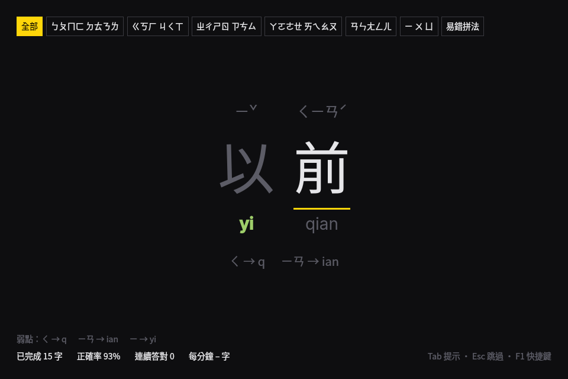

# Bopopin 拼音練習

[English](README.en.md) | 正體中文

**會注音，就會拼音。**



給已經會注音的人用的拼音打字練習。畫面顯示正體中文的詞和它的注音，你打出拼音。
打錯時字只會抖一下；按 Tab 才會顯示這個字的注音怎麼變成拼音（ㄌ → l、ㄧㄡ → iu），
打錯的詞過幾個詞之後會再出現。

它會記住你常打錯的音，關掉再開也記得，並且更常出含有這些音的詞，直到你打對為止。

字母是直接從鍵盤讀的，所以開著新酷音之類的中文輸入法也能練習。

## 課程

| 課程 | 練習內容 |
| --- | --- |
| 全部 | 所有的詞 |
| ㄅㄆㄇㄈ ㄉㄊㄋㄌ | b p m f d t n l |
| ㄍㄎㄏ ㄐㄑㄒ | g k h j q x |
| ㄓㄔㄕㄖ ㄗㄘㄙ | zh ch sh r z c s |
| ㄚㄛㄜㄝ ㄞㄟㄠㄡ | a o e ai ei ao ou |
| ㄢㄣㄤㄥㄦ | an en ang eng er |
| ㄧ ㄨ ㄩ | 以 y、w、yu 開頭的音節 |
| 易錯拼法 | ü（在 n 和 l 後面打 v）、iu、ui、un、ong |

## 快捷鍵

| 按鍵 | 功能 |
| --- | --- |
| A – Z | 打出目前這個字的拼音 |
| Tab | 顯示這個字的拼音 |
| Ctrl+H | 一直顯示拼音，或取消 |
| Esc | 跳過這個詞 |
| Ctrl+← → | 上一課或下一課 |
| Ctrl+R | 重設成績和弱點紀錄 |
| F1 | 顯示或隱藏快捷鍵 |
| Ctrl+Q | 離開 |

## 編譯

```bash
bin/build
bin/test
cmake --install build --prefix ~/.local
```

詞庫在 `src/words.tsv`，一行一個詞：詞、一個 Tab、每個字一個注音音節。
讀音已和 libchewing 的詞庫核對過。
